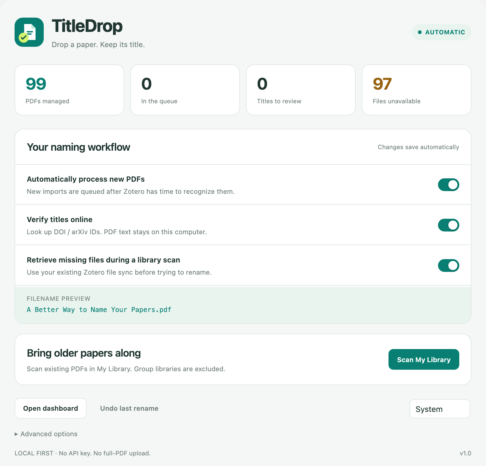
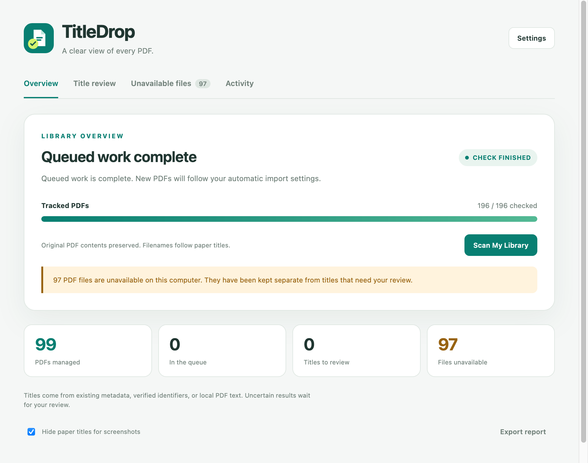
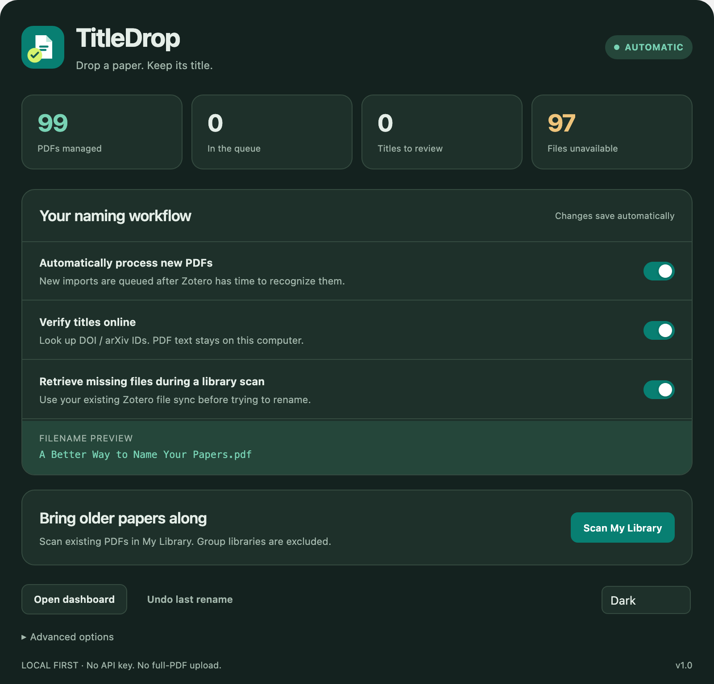
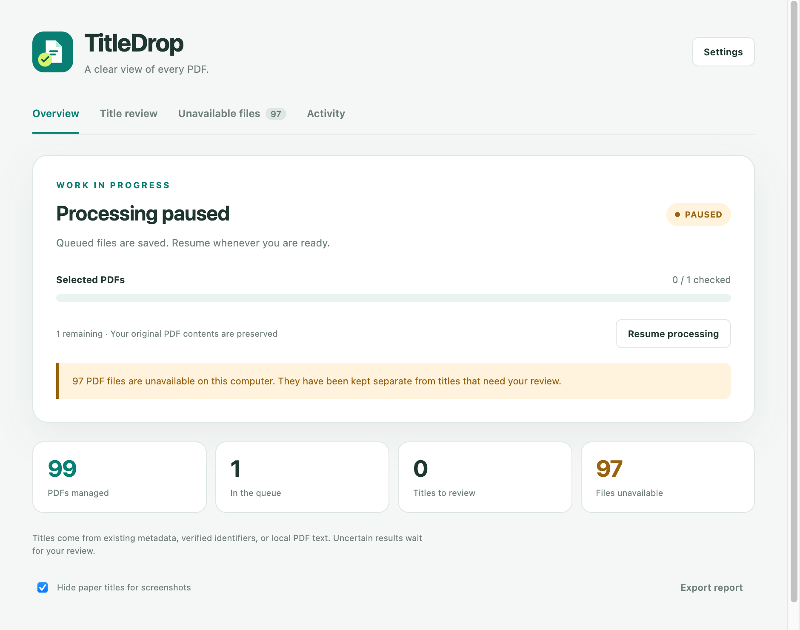
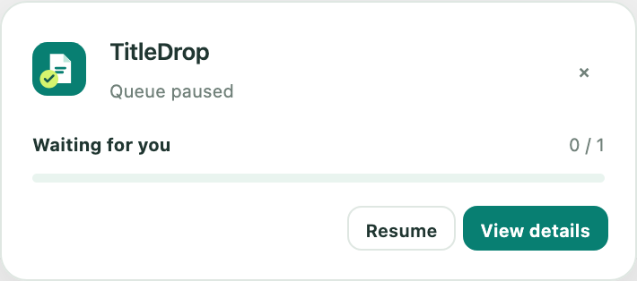

<p align="center"></p>
<h1 align="center">TitleDrop</h1>
<p align="center"><strong>Drop a paper. Keep its title.</strong></p>

**TitleDrop is a Zotero plugin for automatically renaming PDF attachments and their files using paper titles.** It helps with new imports, existing library attachments, and standalone PDFs that Zotero could not recognize, with manual review when a title is uncertain.

[**Download v1.0**](https://github.com/offmor/TitleDrop/releases/download/v1.0/titledrop-1.0.xpi) · [Release notes](https://github.com/offmor/TitleDrop/releases/tag/v1.0) · [Report an issue](https://github.com/offmor/TitleDrop/issues) · [MIT License](LICENSE)

**Compatibility:** Zotero 10.0.x. Tested on Zotero 10.0.6 for macOS. v1.0 is the initial public beta; Windows/Linux and recognition accuracy across a broad range of publishers still need validation. No AI account, API key, or separate Python installation is required to use the plugin.

[Features](#features) · [Installation](#installation) · [Usage](#usage) · [Settings](#settings) · [FAQ and troubleshooting](#faq-and-troubleshooting) · [Privacy](#privacy) · [Contributing and support](#contributing-and-support) · [Credits](#credits)



## Features

- **Automatic naming for new PDFs.** Gives Zotero's native recognizer time to finish, then names the attachment and its file after the paper title.
- **Support for older papers.** Scan My Library or process only selected PDFs and parent items.
- **Standalone PDF recognition.** Use verified DOI/arXiv identifiers or local first-page text to create a parent item when possible.
- **Review uncertain titles.** Inspect a proposed title, enter a correction, or keep the original name.
- **Visible progress.** Follow a dashboard or a compact progress widget, with pause and resume controls.
- **Separate missing-file handling.** Retry unavailable PDFs through your existing Zotero file sync without treating them as successfully renamed.
- **Recovery and activity.** Undo recent renames and export a local JSON report.
- **Appearance and privacy controls.** Choose light, dark, or system appearance; hide paper names when taking dashboard screenshots.



<details>
<summary>More screenshots</summary>

**Dark appearance**



**Paused processing**



**Compact progress widget**



</details>

## Installation

1. Download [`titledrop-1.0.xpi`](https://github.com/offmor/TitleDrop/releases/download/v1.0/titledrop-1.0.xpi) from the [v1.0 release](https://github.com/offmor/TitleDrop/releases/tag/v1.0). Use the `.xpi` asset, rather than a source-code archive.
2. In Zotero, open **Tools → Plugins**.
3. Click the gear menu and choose **Install Plugin From File…**.
4. Select the downloaded `.xpi` and complete the installation.
5. Open **Settings → TitleDrop**, or **Tools → TitleDrop → Settings…**.

If your browser tries to install the XPI as a browser extension, save the download link to a file and install that file inside Zotero. Restart Zotero if its installer requests it.

Automatic processing starts enabled for new PDFs. Installing the plugin does not scan or rename your existing library automatically.

For consistent naming, set Zotero's own filename format to `{{ title }}`. During the public beta, install updates manually from Releases; GitHub's latest-release update feed excludes pre-releases.

## Usage

### New PDFs

Drag a PDF into Zotero as usual. TitleDrop queues the new attachment, waits for native recognition, and then attempts to use the paper title. If a title cannot be established with enough evidence, the PDF appears in **Title review**.

Try the original [fictional demonstration PDF](examples/synthetic-paper.pdf). Its expected filename is:

```text
A Simple Method for Organizing Research Papers.pdf
```

The [example first page](docs/images/example-first-page.png) and [fixture notes](examples/README.md) contain no real research material.

### Existing library or selected papers

- To process existing PDFs in your personal library, click **Scan My Library** in Settings or the dashboard. Group libraries and Trash are excluded.
- To process specific PDFs, select their attachments or parent items, then right-click and choose **TitleDrop: Rename Selected PDFs**. The same action is available under **Tools → TitleDrop**.
- Open **Tools → TitleDrop → Processing Dashboard** to follow the queue.

**Pause processing** stops the next queued job; an operation already in progress may finish. **Resume processing** continues the saved queue. The automatic-import switch controls new-import automation separately.

### Review a title

1. Open **Title review** in the dashboard.
2. Choose **Open PDF** to check the paper's title.
3. Enter or correct the title and click **Use title**, or choose **Keep original** to leave the attachment alone.

Turn off **Hide paper titles for screenshots** to display and edit proposed titles. **Show in library** selects the corresponding attachment in Zotero.

### Restore missing PDFs

**Unavailable files** means the attachment record exists but its PDF is unavailable locally. TitleDrop can request the file through your existing Zotero sync configuration during a library scan. If retrieval fails, the current name stays unchanged.

Restore the PDF from another device or file sync, then choose **Retry downloads**. Missing files are listed separately from titles that need review.

### Undo and export

**Undo last rename** restores the previous attachment title and filename while keeping bibliographic metadata. The last 80 renames are retained. Undo refuses to overwrite another file, act on a filename changed since the rename, or race active processing. An undone PDF is excluded from automatic naming until you explicitly process it again.

**Export report** saves a JSON report with counts, review records, rename history and recent activity. Reports may contain paper titles and filenames; screenshot privacy does not anonymize them.

## Settings

Changes save automatically.

| Setting | Default | Purpose |
| --- | --- | --- |
| Automatically process new PDFs | On | Queue newly imported PDF attachments. |
| Verify titles online | On | Look up explicit DOI/arXiv identifiers and check the result against the first page. |
| Retrieve missing files during a library scan | On | Use your existing Zotero file sync to request stored PDFs. |
| Import wait time | 6 seconds | Choose 3, 6, or 10 seconds; native recognition still takes priority. |
| Show rename notifications | On | Display a notification when a PDF is renamed. |
| Appearance | System | Choose System, Light, or Dark. |
| Hide paper titles for screenshots | Off | Hide filenames, proposed titles and review details in the dashboard. |

Import wait time and notifications are under **Advanced options**. Screenshot privacy is in the dashboard.

## FAQ and troubleshooting

| Situation | What to check |
| --- | --- |
| Older PDFs did not change after installation | New imports are automatic; use **Scan My Library** or **Rename Selected PDFs** for existing attachments. |
| A new PDF keeps its original filename | Check that automatic processing is on and the queue is not paused. Wait for native recognition, then inspect **Title review** and **Unavailable files**. |
| The proposed title is hidden or cannot be edited | Turn off **Hide paper titles for screenshots** in the dashboard. |
| Zotero says the plugin is incompatible | v1.0 declares Zotero **10.0.x** compatibility. Older Zotero versions are not supported by this package. |
| A scan finishes with unavailable files | These PDFs were not renamed. Restore or sync the files and use **Retry downloads**. A completed check does not mean every file was available. |
| The name changes again later | Check Zotero's filename format and any other attachment-renaming plugins. Align the naming rules and test with one PDF. |
| A PDF cannot be recognized | Confirm it has selectable text and a readable first-page title. For ambiguous layouts, enter the exact title in **Title review**. OCR is not included. |
| A filename differs slightly from the title | Filesystem-invalid characters are removed, long names are shortened, and collisions receive a suffix. The attachment label can keep the fuller title. |

TitleDrop does not require an LLM or an API key. The development-assistance credit below does not indicate a runtime AI dependency.

## Updating and uninstalling

Download an XPI from [Releases](https://github.com/offmor/TitleDrop/releases) and install it through the same **Install Plugin From File…** menu to replace the installed version. Pre-release builds use manual updates. Check the [changelog](CHANGELOG.md) before changing versions.

To stop using TitleDrop, disable or remove it under **Tools → Plugins**. This stops automation but does not reverse completed renames or delete bibliographic items. Use **Undo last rename** before removing the plugin if you want to restore recent filenames. Its local processing-state file is retained, so reinstalling can recover that state.

## How it works

1. If Zotero creates a parent item, use its title.
2. For a standalone PDF, extract the opening page locally using Zotero's PDF worker.
3. When enabled, look up an explicit DOI or arXiv identifier. Both the identifier and returned title must agree with the PDF; later references are not searched for identifiers.
4. Otherwise, use PDF title metadata that matches the page, or a clearly identifiable title block. Create a minimal parent item and leave unverified bibliographic fields blank.
5. Send uncertain results to manual review.

Invalid filename characters are removed, very long filenames are shortened, and collisions receive a suffix. Existing files are not overwritten. Library changes use Zotero APIs and preserve the original attachment identity, annotations and PDF contents. Newly created parent items inherit the attachment's collections.

## Privacy

TitleDrop processes PDF contents and extracted text locally. Optional identifier lookups send DOI/arXiv identifiers to `api.crossref.org` or `arxiv.org`. Missing-file retrieval uses your existing Zotero sync configuration. TitleDrop has no telemetry and does not upload PDFs to an AI service.

Disable **Verify titles online** and **Retrieve missing files during a library scan** to disable those TitleDrop network operations. Zotero's own recognition, sync, and other plugins operate independently.

Processing state is stored in `titledrop-state.json` in the Zotero data directory using atomic writes. Uninstalling stops TitleDrop automation; existing filenames, bibliographic items and the local state file remain. Dashboard screenshot privacy does not hide Zotero's main library view or exported report contents.

## Limitations

- Scanned PDFs without selectable text, encrypted files, cover pages and ambiguous layouts can require manual title entry.
- Existing parent metadata is trusted and may itself be incorrect. TitleDrop is not a complete bibliographic repair tool.
- New linked PDFs are deferred to review. Explicitly processing selected linked PDFs or an existing library can rename their external files.
- Recognition is not guaranteed. The current tests are engineering checks, not an accuracy benchmark across publishers.
- Live UI testing currently covers Zotero 10.0.6 on macOS. Other operating systems and future Zotero versions need further testing.

See [validation details](VALIDATION.md) for the checks performed.

## Contributing and support

[Open an issue](https://github.com/offmor/TitleDrop/issues/new/choose) for a bug report or feature request. Include your Zotero version, TitleDrop version, operating system, steps to reproduce, and the expected versus actual result.

For recognition issues, share an openly available PDF link or a synthetic example. Do not upload unpublished papers, personal library reports, credentials, or unreviewed logs. Screenshots with paper-title privacy enabled are useful for UI issues.

Pull requests are welcome. See [Contributing](CONTRIBUTING.md) for the development workflow and test expectations. TitleDrop is an independent community plugin and is not an official Zotero product.

## Development

Use Node.js 24 and Python 3.11 or newer. No npm dependencies are required.

```sh
git clone https://github.com/offmor/TitleDrop.git
cd TitleDrop
npm test
npm run build
```

The local build produces `dist/titledrop-1.0.xpi` with automatic updates disabled. To build release assets for this repository:

```sh
python3 scripts/build.py --repo offmor/TitleDrop
```

This produces an XPI with the repository's update URL and an `updates.json` manifest containing its SHA-256 digest. Building does not publish a release. The XPI contains only `addon/`; examples, screenshots, reports and development files are excluded.

GitHub Actions runs the tests and builds an installable artifact. See [Contributing](CONTRIBUTING.md), [the release guide](docs/RELEASING.md), and [Changelog](CHANGELOG.md). Regenerating the fictional example additionally requires ReportLab and Poppler, as described in [examples](examples/README.md).

## Credits

GPT-6-Astra assist

## License

[MIT License](LICENSE). Copyright © 2026 TitleDrop contributors.
